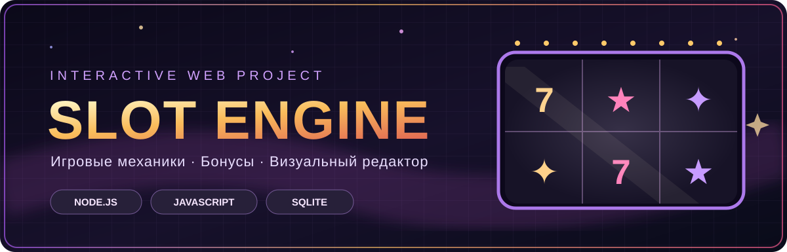
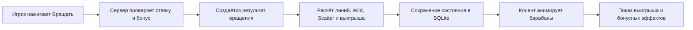

<div align="center">



# SLOTJAVA

### Конструктор браузерных игровых автоматов

**Настраиваемые барабаны · Бонусные механики · Гибкая админ-панель · Анимированные интерфейсы**


*Веб-проект с игровыми механиками и редактором контента. Использует условные тестовые очки — без платежей и вывода денег.*

[**Быстрый старт**](#-быстрый-старт) · [**Возможности**](#-возможности) · [**Администрирование**](#-администрирование) · [**Архитектура**](#-структура-проекта)

</div>

---

## ✨ О проекте

**SlotJava** — браузерная игровая платформа на Node.js и JavaScript. Сервер рассчитывает результаты вращений, выигрыши и состояние бонусных серий. Клиент отвечает за анимацию барабанов, визуальные эффекты, управление ставкой и представление результатов. Администратор может изменять контент и параметры доступных игр через веб-интерфейс.

Игровые режимы могут отличаться размером поля, таблицами выплат и специальными механиками. **README намеренно не привязан к названиям и числу игр**: текущие режимы задаются конфигурацией приложения, а правила и медиа хранятся отдельно для каждого режима.

## 🎮 Возможности

| Подсистема | Что реализовано |
|:--|:--|
| 🎰 Игровое поле | Вертикальные барабаны, анимация вращения и последовательной остановки, индивидуальное оформление |
| 🏆 Выигрыши | Серверный расчёт по настройкам символов, линиям и множителям (зависит от игрового режима) |
| ✨ Wild | Замена обычных символов в выигрышах, визуальные эффекты и специальные правила бонусов |
| 🌠 Scatter | Настраиваемые шансы появления, запуск бесплатных вращений и повторные бонусы |
| 🔥 Бонусные серии | Бесплатные вращения, накопление результатов, множители, закрепляемые или расширяющиеся символы — в зависимости от режима |
| 🖼️ Медиатека | Загрузка, переименование, замена, удаление и назначение изображений символов и фонов |
| 🎵 Звук | Фоновая музыка, звуки вращения, обычных и крупных выигрышей |
| 🎛️ Админ-панель | Символы, выплаты, линии, вероятности, бонусные правила и настройки оформления |
| 👤 Пользователи | Регистрация, авторизация, роли, сессии и раздельные настройки игроков |
| 💾 Данные | SQLite для настроек и игровых состояний, отдельное хранилище загруженных файлов |

> **Важно:** разные механики не обязательно включены в каждом игровом режиме. Например, расширение Wild на весь барабан и закрепление Wild в одной ячейке — разные правила, применяемые в соответствующих режимах.

## 🚀 Быстрый старт

**Требования:** Node.js **20+** и npm.

```bash
git clone https://github.com/Denis-create-boop/SlotJava.git
cd SlotJava
npm install
npm run create-admin
npm start
```

После запуска перейди на **http://localhost:3000**. При создании администратора введи логин и уникальный пароль длиной **не менее 12 символов**.

Для **GitHub Codespaces** выполни те же команды в терминале, открой вкладку **Ports**, найди порт **3000** и нажми **Open in Browser**.

### Обновление уже запущенного проекта

Останови сервер клавишами `Ctrl + C`, затем:

```bash
git pull origin main
npm install
npm start
```

Если браузер показывает старый интерфейс, обнови страницу через **Ctrl + F5**.

### Полезные команды

| Команда | Назначение |
|:--|:--|
| `npm start` | Запуск веб-сервера |
| `npm test` | Запуск автоматизированных тестов |
| `npm run create-admin` | Создание учётной записи администратора |
| `npm run reset-admin-password` | Смена пароля администратора |

## 🧩 Администрирование

Открой **Админ-панель → Управление играми** и выбери нужный режим. Доступные разделы зависят от его особенностей.

**Символы и изображения.** Символы хранятся в базе, картинки — в медиатеке соответствующей игры. Можно загрузить новое изображение, заменить существующее, изменить название и назначить нужному символу. Для Wild предусмотрена отдельная привязка изображения; **собственной цены у Wild нет**, он участвует в комбинации как заменяющий символ.

**Выплаты и линии.** Настраиваются коэффициенты, минимальное число совпадений и/или выигрышные линии — в соответствии с алгоритмом конкретного игрового режима. Изменение изображения не должно изменять цены или идентификатор символа.

**Scatter и бесплатные вращения.** Для каждого режима настраиваются шансы появления Scatter. Таблица наград задаётся вручную:

| Выпало Scatter | Бесплатных вращений |
|:--:|:--:|
| 3 | 10 |
| 4 | 15 |
| 5 | 20 |

Это **пример, а не фиксированное ограничение**: строки можно добавлять, редактировать и удалять. Действует правило **последнего подходящего порога**: если максимальная строка — `5 → 20`, то при 6, 7 и большем количестве Scatter будет использовано **20 вращений**. Если ни один порог не достигнут, бонус не запускается.

**Бонусные настройки.** Отдельные игровые режимы поддерживают закрепляющийся Wild, расширение символов, повторный запуск бонуса, накопление выигрышей, изменение множителя и специальные вероятности выпадения в бонусной серии.

**Оформление.** Можно настроить фон страницы, область барабанов, фон ячеек, логотипы, интерфейсные панели, а также аудиоэффекты. Загруженные изображения не нужно встраивать в исходный код.

## 🏗️ Структура проекта

```text
SlotJava/
├── server.js               # HTTP-маршруты, игровая логика, сессии
├── db.js                   # SQLite, схемы, миграции, сохранение настроек
├── game-admin.js           # Административный интерфейс и его обработчики
├── game-layout.js          # Геометрия и темы игровых режимов
├── slot-bonus.js           # Общие механики Scatter и бонусных вращений
├── egypt-bonus.js          # Правила отдельного бонусного режима
├── space-rules.js          # Выигрышные линии и специальные Wild-правила
├── scatter-awards.js       # Расчёт наград по числу Scatter
├── public/
│   ├── app.js              # Анимация и управление игровым полем
│   ├── style.css           # Темы оформления, эффекты, адаптивный интерфейс
│   └── images/             # Встроенная графика
├── scripts/                # Служебные команды администрирования
├── test/                   # Автоматические тесты
├── .github/assets/         # Графика README
└── data/                   # Локальная БД и загрузки (не входит в Git)
```

### Как происходит вращение



**Результат определяет сервер**, а не визуальная анимация клиента. Это важно для одинакового подсчёта выигрыша и корректного восстановления состояния после перезагрузки страницы.

## 🛠️ Технологии

- **Node.js + Express** — сервер, маршруты и веб-интерфейсы.
- **JavaScript без тяжёлого UI-фреймворка** — клиентское управление и анимации.
- **SQLite / better-sqlite3** — пользователи, баланс, настройки, игровые сессии.
- **Multer** — загрузка изображений и аудио.
- **Helmet, CSRF-проверки и rate limiting** — базовые средства защиты веб-приложения.
- **CSS / SVG / Web Animations API** — игровые эффекты, барабаны и визуальные переходы.
- **Node.js test runner** — тесты механик, включая бонусные расчёты.

## 🔒 Данные и безопасность

- Проект использует **только условные игровые очки**. Это демонстрационное приложение, не платёжная система.
- Пароли хранятся в виде криптографических хешей; игровые запросы требуют авторизации и проверок.
- Папка **`data/`** не отслеживается Git. В ней находятся SQLite-база, файлы загрузок и локальные секреты.
- При переносе на другой компьютер **сохрани всю папку `data/` отдельно**. Одного `git pull` недостаточно, чтобы перенести пользовательские настройки, баланс и загруженные изображения.
- Для публикации в интернете необходимы HTTPS, резервное копирование, защищённый доступ администратора и постоянное дисковое хранилище.
- После изменения настроек выплат и вероятностей рекомендуется проверить их тестами и на локальной копии приложения.

## 🤝 Разработка

Проект развивается итеративно: новые темы и режимы, улучшения анимации, инструменты администрирования и тесты игровых механик.

Перед изменением расчётов полезно запустить:

```bash
npm test
```

Изменения в исходниках синхронизируются через Git, **но рабочая база и загруженные файлы остаются на той машине, где запущен проект**.

---

<div align="center">

**SLOTJAVA** · *Build the reels. Shape the rules. Own the experience.*

<sub>Создано для экспериментов с браузерными игровыми механиками и дизайном интерфейсов.</sub>

</div>
